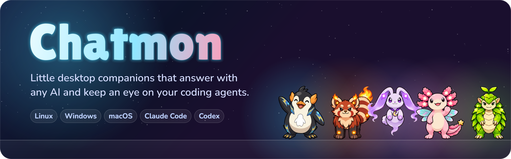
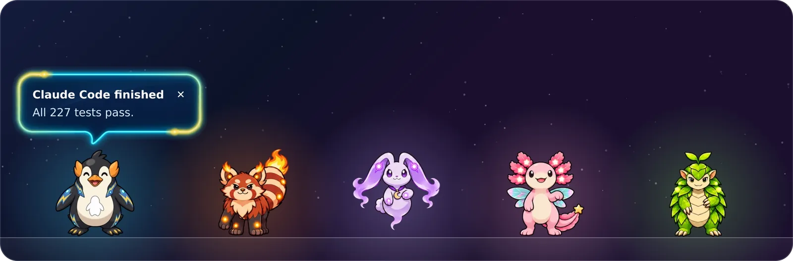
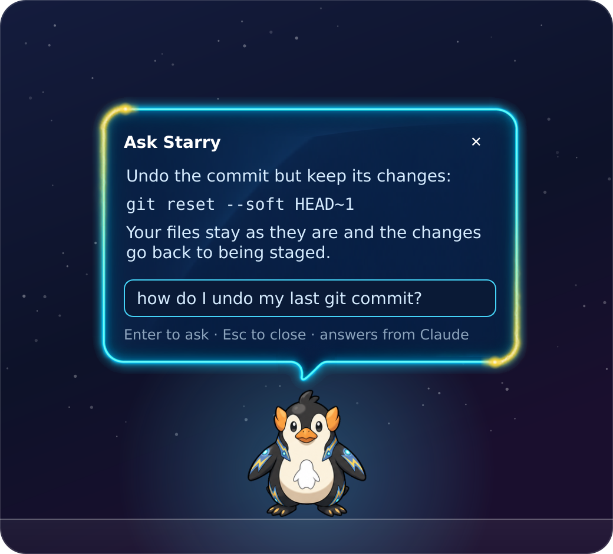
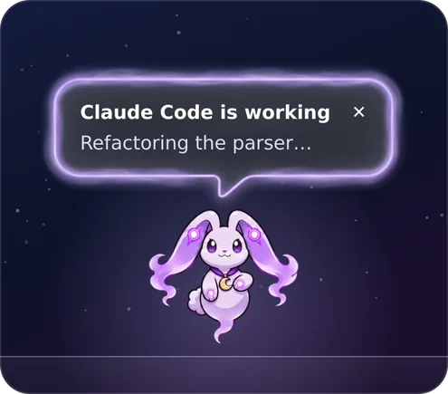
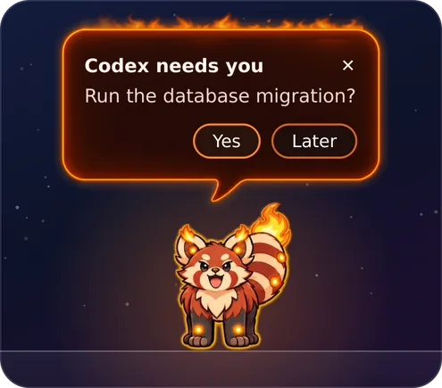
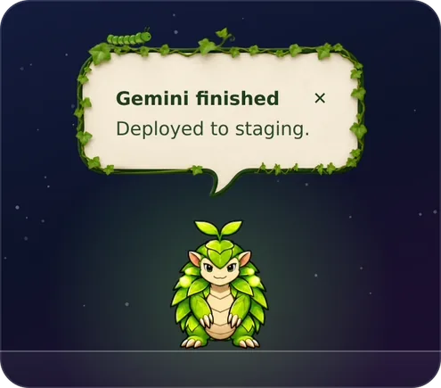
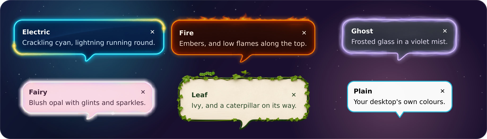

<p align="center">
  
</p>

<p align="center">
  <a href="https://github.com/RandyNorthrup/chatmon/stargazers"></a>
  <a href="https://github.com/RandyNorthrup/chatmon/releases"></a>
  <a href="https://github.com/RandyNorthrup/chatmon/releases/latest"></a>
  <a href="https://github.com/RandyNorthrup/chatmon/actions/workflows/ci.yml"></a>
  <a href="LICENSE"></a>
</p>

<p align="center">
  <b>A little creature that lives along the bottom of your screen, answers with the AI you already use,<br>
  and keeps an eye on your coding agents.</b><br>
  Linux · Windows · macOS
</p>

<p align="center">
  
</p>

<p align="center">
  <a href="#install">Install</a> ·
  <a href="#meet-the-chatmons">The chatmons</a> ·
  <a href="#brains-what-answers-your-questions">Brains</a> ·
  <a href="#ai-agents-let-them-tell-your-chatmon-what-theyre-doing">AI agents</a> ·
  <a href="#privacy-and-security">Privacy</a>
</p>

## Meet the chatmons

Pick one under **Companion** in the menu; it changes on the spot. Each has the same twelve animations,
does everything the others do, and talks in chat bubbles of its own.

<table>
  <tr>
    <td align="center" width="20%"><br><b>Electric penguin</b><br><sub>the default · <code>penguin</code></sub><br><sub>Navy glass, lightning running round a cyan edge</sub></td>
    <td align="center" width="20%"><br><b>Fire red panda</b><br><sub><code>fire-red-panda</code></sub><br><sub>An ember edge with low flames along the top</sub></td>
    <td align="center" width="20%"><br><b>Ghost rabbit</b><br><sub>it floats · <code>ghost-rabbit</code></sub><br><sub>Frosted glass in a drifting violet mist</sub></td>
    <td align="center" width="20%"><br><b>Fairy axolotl</b><br><sub><code>fairy-axolotl</code></sub><br><sub>Blush opal with glints and sparkles</sub></td>
    <td align="center" width="20%"><br><b>Leaf pangolin</b><br><sub><code>leaf-pangolin</code></sub><br><sub>Ivy, with a caterpillar crawling along it</sub></td>
  </tr>
</table>

## What it does



- **Ask it anything.** Click it and type. It answers with the AI you already use: a command-line tool
  you're signed in to (Claude Code, Codex, Gemini CLI, Muse Code, Grok, GitHub Copilot CLI), a model
  server on your own computer (Ollama, LM Studio, llama.cpp, vLLM), or an API: Anthropic, OpenAI,
  Gemini, xAI, Meta, Mistral, DeepSeek, Groq, Together, Fireworks, Cerebras, Perplexity, OpenRouter,
  Amazon Bedrock, Azure, or anything that speaks the OpenAI or Anthropic API. Pick the model, how hard
  it thinks, and whether it thinks at all, right from the menu.
- **Keeps an eye on your coding agents.** It thinks while one works, flaps for attention when one needs
  your approval, and hops when it's done.
- **Reminders and timers**, typed the way you'd say them: *remind me in 20m to stretch*, *remind me at
  3pm to call Sam*, *timer 10 min for the pasta*, *focus 50*. No AI needed.
- **Breaks.** A nudge after an hour at the screen; locking the screen for five minutes counts as one.
- **Heads-ups.** A low battery, a disk filling up, system updates waiting.
- **Stays out of your way.** It wanders about, naps when you ignore it, peeks out from behind the
  taskbar, and clicks go straight through everything but the chatmon itself.

<br clear="right">

## Your coding agents, at a glance

<table>
  <tr>
    <td align="center" width="33%"><br><b>Working</b><br><sub>It thinks; after a minute, it charges up</sub></td>
    <td align="center" width="33%"><br><b>Needs you</b><br><sub>It flaps and says what the agent is waiting for</sub></td>
    <td align="center" width="33%"><br><b>Done</b><br><sub>It hops and says it finished</sub></td>
  </tr>
</table>

Claude Code, Codex, Gemini CLI, Muse Code, Grok, GitHub Copilot CLI, Cursor, Cline, Qwen Code and Devin
connect from the menu, and anything else that can run a command can join in ([details](#ai-agents-let-them-tell-your-chatmon-what-theyre-doing)).

## Bubble styles

<p align="center"></p>

**Bubble style** starts on **Match companion**, which follows whichever chatmon you pick. Choose a style
by name (or **Plain**, in your desktop's own colours) and it stays put whichever chatmon you pick;
**Animate bubbles** holds the edges still. All of it is remembered, and can be set in the settings file
(`companion`, `bubble_style`, `bubble_effects`).

## Install

Download the one for your computer from the [latest release](https://github.com/RandyNorthrup/chatmon/releases/latest):

| Your computer                          | Download                                         | Then                                                     |
| -------------------------------------- | ------------------------------------------------ | -------------------------------------------------------- |
| **Windows** 10 or 11                   | `Chatmon-<version>-windows-x64-setup.exe`        | Run it. It installs for you alone (no administrator needed) and asks whether to add Chatmon to the Start menu and the desktop, and to start it when you log in. |
| **macOS** 13+, Apple silicon or Intel  | `Chatmon-<version>-macos-arm64.pkg` or `-intel.pkg` | Open it. Chatmon goes in Applications, and the `chatmon` command your agents' hooks run goes on your PATH. (The `.dmg` is the same app to drag in yourself, without that command.) |
| **Ubuntu** 24.04+, **Debian** 13+      | `chatmon_<version>-1_all.deb`                    | `sudo apt install ./chatmon_<version>-1_all.deb`         |
| **Fedora** 44+                         | `chatmon-<version>-1.noarch.rpm`                 | `sudo dnf install ./chatmon-<version>-1.noarch.rpm`      |

Then start it the way you start anything else: the Start menu, Launchpad or Spotlight, or your desktop's
app menu (or `chatmon` in a terminal). On macOS it lives in the menu bar, not the Dock. The Linux
packages run on your system's Python and PyQt6, which apt and dnf install along with them.

The Windows installer, and Chatmon's programs, are signed by Randy Northrup. For a while after a new
version comes out, SmartScreen may still ask about it: check it names Randy Northrup, then **More info** and
**Run anyway**. The macOS app isn't signed yet, so the first time, **System Settings → Privacy & Security →
Open Anyway**. From 0.6.0 on, Chatmon updates itself: it says when a new version is ready, and installs it
when you click **Update now**. To uninstall: **Settings → Apps** on Windows, `sudo apt remove chatmon` or
`sudo dnf remove chatmon` on Linux, and on macOS drag Chatmon to the Trash (after a `.pkg`, also
`sudo rm /usr/local/bin/chatmon`). Your settings stay, for next time. On Linux and macOS, run
`chatmon hooks disconnect all` first if you connected any coding agents, so none is left running a chatmon
that's gone; the Windows uninstaller does that itself.

### With Python instead

You need Python 3.11 or newer.

```sh
pipx install git+https://github.com/RandyNorthrup/chatmon
chatmon
```

Without pipx: `python3 -m pip install --user git+https://github.com/RandyNorthrup/chatmon`. Each
[release](https://github.com/RandyNorthrup/chatmon/releases) also has the wheel, for
`pipx install chatmon-<version>-py3-none-any.whl`. Or run it from a clone, with PyQt6 installed
(`python3 -m pip install PyQt6`, or `sudo apt install python3-pyqt6` on Debian and Ubuntu):

```sh
git clone https://github.com/RandyNorthrup/chatmon
cd chatmon
bin/chatmon          # Windows: py bin\chatmon
```

Agent hooks call `chatmon` by name, so if you run it from a clone, put the launcher on your PATH:
`ln -s "$PWD/bin/chatmon" ~/.local/bin/` (on Windows, `pipx install --editable .` in the clone). For
battery levels on Windows and macOS, also install `psutil`.

The first time, it asks what it should be called. Right-click it and tick **Start when I log in** to keep
it around. On Windows that starts `chatmonw`, which installs alongside `chatmon` and runs it without a
console window; run that way, Chatmon writes any problems to `chatmon.log` in its state folder. On macOS,
Chatmon.app becomes one of your Login Items, listed by name in System Settings › General › Login Items,
where you can turn it off too (run from source or pip, a LaunchAgent starts it instead).

<details>
<summary><b>Coming from Penguin companion</b></summary>

Chatmon was called Penguin companion until 0.3.0. Quit the old one (right-click, **Quit**), then swap
the package:

```sh
pipx uninstall penguin-companion
pipx install git+https://github.com/RandyNorthrup/chatmon
chatmon
```

The first time it runs, Chatmon moves your settings, name and reminders over from the
`penguin-companion` folders, switches **Start when I log in** to the new name, and swaps the hooks of
any agents you connected for `chatmon` ones (Claude Code gets the `chatmon` plugin in place of
`penguin-companion`). Until then the old hooks keep working: `penguin-companion` is still installed as
another name for `chatmon`, for now.

Claude Code and Muse Code can drop the old plugin as soon as the old package is uninstalled, before
Chatmon gets to move it. If either shows unticked under **AI agents** afterwards, tick it again (your
chatmon reminds you on that first run). From 0.3.0 on, Chatmon keeps its Claude Code marketplace in its
own state folder, so upgrades can't take it away again.

</details>

## Using it

| You                              | It                                                       |
| -------------------------------- | -------------------------------------------------------- |
| Click it                         | Opens the ask box (or wakes up, or answers an alert)     |
| Drag it                          | Comes along; let go and it drops back to the taskbar     |
| Right-click it, or the tray icon | The menu: ask, chats, remind, focus timer, reminders, brain, companion, bubble style, AI agents, walk, hide, help & updates, settings |
| Click the tray icon              | Hides it, or brings it back                              |
| **+** in the ask box             | Attach files, a picture or text; or paste them (Ctrl+V), or drop them on it |
| **History** in the ask box       | Your chats: carry on with one, rename it, pin it to the top, save it as Markdown, or delete it |

Besides questions, the ask box does a lot without any AI: reminders and timers, focus sessions, notes, a
stopwatch, sums (*15% of 80*), unit conversions (*5 km in miles*), the time and date (*days until
Christmas*), coins and dice (*roll 2d6*), passwords, and *status* (battery, disks, reminders, the brain in
use). Ask it *help* for the full list. These are answered at once, marked as answered without AI, never
sent anywhere, and never part of a chat; anything else goes to the brain you picked.

It keeps out of your way: bubbles wait while a full-screen app, a presentation, Do Not Disturb (KDE, GNOME)
or Focus (Windows 11) is on, and the chatmon gives way to full-screen windows (something that needs you still
comes through as a system notification; on macOS, where only an app signed with an Apple Developer ID may
send one, it waits for you instead). Time away from the keyboard counts toward a break, locked or not,
as does sleep. In power-saver mode it draws less often, and on Windows not at all while the screen is locked
or off. Reduced motion and high contrast are followed unless you choose otherwise. With a screen reader
running, bubbles and answers are read out (by Orca 49+ or VoiceOver themselves, or as a notification, which
Narrator, NVDA and JAWS read), and typing a bubble's button in the chat presses it.

## Brains: what answers your questions

**Automatic** (the default) uses the first of these it finds:

- an AI command-line tool you're signed in to: `claude`, `codex`, `gemini`, `muse`, `grok`, `copilot`.
  It runs in an empty folder of its own with its tools off or read-only, so a question can't touch your
  files;
- a model server running on this computer: Ollama, LM Studio, llama.cpp or vLLM, with whichever model it
  has loaded.

**APIs are billed per question, so Automatic never picks one**, even if its key is set. Pick it under
**Brain** in the menu, or name it in the settings.

### Model, effort and thinking

Under **Brain**, the brain in use has three more menus, and what you pick is remembered for each brain:

- **Model**: the provider's current models, the usual one first.
- **Effort**: how hard it thinks before it answers. Lower is quicker and cheaper; a chatmon's answers are
  a few sentences, so the APIs start low where the provider allows.
- **Thinking**: the model's own default, on, or off, where the model can be told. A choice a model
  doesn't take is greyed out with the reason (Claude Opus 5.5 always thinks, for one), and switching to
  such a model just drops the choice.

| Brain            | Key in                     | Default model | Also in the menu |
| ---------------- | -------------------------- | ------------- | ---------------- |
| `anthropic-api`  | `ANTHROPIC_API_KEY`        | `claude-opus-5-5` | Sonnet 5.5, Haiku 5.5, Fable 5.2 |
| `openai-api`     | `OPENAI_API_KEY`           | `gpt-6.1-sol` (Responses API) | `gpt-6.1-terra`, `gpt-6-astra`, `gpt-6-luna` |
| `gemini-api`     | `GEMINI_API_KEY`           | `gemini-3.8-flash` | `gemini-4-carbon`, `gemini-4-argon`, `gemini-3.5-flash-lite` |
| `xai-api`        | `XAI_API_KEY`              | `grok-4.7` (Responses API) | `grok-4.6`, `grok-4.20-0309-non-reasoning` |
| `meta-api`       | `MODEL_API_KEY`            | `muse-spark-1.3` | `muse-ember-1.0` (new, the cheapest), `muse-wonder-1.0` (preview) |
| `mistral-api`    | `MISTRAL_API_KEY`          | `mistral-small-latest` | `mistral-large-4-0` |
| `deepseek-api`   | `DEEPSEEK_API_KEY`         | `deepseek-v4-pro` | `deepseek-flash` |
| `groq-api`       | `GROQ_API_KEY`             | `openai/gpt-oss-120b` | `openai/gpt-oss-20b` |
| `together-api`   | `TOGETHER_API_KEY`         | `moonshotai/Kimi-K3.1-Pro` | GLM 5.3, DeepSeek V4.1 Flash, gpt-oss-120b |
| `fireworks-api`  | `FIREWORKS_API_KEY`        | `accounts/fireworks/models/glm-5p3` | Kimi K3.1 Pro |
| `cerebras-api`   | `CEREBRAS_API_KEY`         | `gpt-oss-120b` | `qwen-3.8-27b` |
| `perplexity-api` | `PERPLEXITY_API_KEY`       | `perplexity/sonar`, with web search (Agent API) | GPT 6.1 Sol, Gemini 3.8 Flash, Claude Sonnet 5.5 |
| `openrouter`     | `OPENROUTER_API_KEY`       | `openrouter/auto` | GPT 6.1 Sol, Gemini 3.8 Flash, Claude Sonnet 5.5 |
| `bedrock-api`    | `AWS_BEARER_TOKEN_BEDROCK` and `AWS_REGION` | `global.openai.gpt-6.1-sol` | Terra, Astra, Luna |

The command-line tools take a model and an effort from the menu too, where the tool has a flag for them
(Claude Code, Codex, Muse Code and Copilot take both; Gemini CLI and Grok a model). The model names were
checked on each provider's own pages on 10 November 2026.

Change any of it, or add your own brain (any command that reads a question and prints an answer, or any
endpoint for the Anthropic Messages, OpenAI Responses or OpenAI Chat Completions API, Azure included),
in the settings file, which has examples. The Claude Code and Grok brains have been tried; the others
follow their tools' documented options.

## AI agents: let them tell your chatmon what they're doing

Your chatmon offers to connect the agents it finds: a bubble with **Connect** and **Not now**, asked again
only if it went unanswered. The Windows installer can connect them as it installs, if you tick **Connect
the coding agents found here**. After that, right-click your chatmon, open **AI agents**, and tick or
untick the ones you use; or from a terminal:

```sh
chatmon hooks                 # what's here and what's connected
chatmon hooks connect claude  # or: codex, gemini, muse, grok, copilot, cursor, cline, qwen, devin, all
chatmon hooks disconnect claude
chatmon hooks show cursor     # how to do it by hand
```

| Agent              | How it's connected                                                    |
| ------------------ | --------------------------------------------------------------------- |
| Claude Code        | A Claude Code plugin, installed with `claude plugin` (on your PATH, or inside Claude Code's VS Code, Cursor or Windsurf extension) |
| Codex              | Its `notify` program, in `~/.codex/config.toml`                       |
| Gemini CLI         | Hooks in `~/.gemini/settings.json`                                    |
| Muse Code          | A Muse plugin, installed and approved with `muse plugins`             |
| Grok               | Its own file, `~/.grok/hooks/chatmon.json`                            |
| GitHub Copilot CLI | Its own file, `~/.copilot/hooks/chatmon.json`                         |
| Cursor             | Hooks in `~/.cursor/hooks.json`                                       |
| Cline              | Hook scripts in `~/Documents/Cline/Hooks` (turn on Cline's "Enable Hooks") |
| Qwen Code          | Hooks in `~/.qwen/settings.json`                                      |
| Devin CLI          | Hooks in `~/.config/devin/config.json`                                |

In Claude Code you can also add the plugin yourself: `/plugin install chatmon --marketplace RandyNorthrup/chatmon`.
A window of Claude Code that was open when you connected it can switch the plugin off again when it saves its
settings; your chatmon says so once, with a button to switch it back on.

For anything else (Aider, Kiro, OpenCode, Amp, a CI script), have it run
`chatmon notify working|needs-you|done|success|error --source NAME`; `chatmon hooks show any` has the
details.

| Event       | Your chatmon                                                       |
| ----------- | ------------------------------------------------------------------ |
| `working`   | Thinks; after a minute, charges up                                 |
| `needs-you` | Flaps and says what the agent is waiting for, until you click OK   |
| `done`      | Hops and says it finished                                          |
| `success`   | Fires a little beam                                                |
| `error`     | Says something went wrong                                          |

`chatmon say TEXT` and `chatmon remind in 10m to stretch` work from any script too.

## Privacy and security

- **Nothing is collected.** No telemetry, no accounts. What leaves your computer is a question you type,
  sent to the brain you chose, and once a day, Chatmon asking GitHub for its latest release (it says only
  that it's Chatmon and which version; GitHub sees your IP address, as any website does). **Help & updates
  → Check for updates every day** turns that off.
- **Your chats stay on this computer.** They're kept in Chatmon's state folder, one file each, readable by
  you alone, so **Chats** (or **History** in the ask box) can bring one back to carry on. What's kept is
  what you saw: your questions, the answers, and the names of what you attached, never the files, pictures
  or text themselves. **Keep chat history** off keeps chats only until Chatmon quits; **Clear chat history**
  deletes them all.
- **What you attach goes only to the brain you ask, and only what you picked.** Chatmon reads a file when
  you attach it, never a folder, a device, a pipe or a network path, and nothing else on your computer.
  Text is quoted in your question between markers no file can fake; pictures (made smaller first) and PDFs
  go only to the brains that can read them. Attached text goes again with later questions only to the
  brain you first gave it to, and only until Chatmon quits. A command-line AI tool that can read files
  (Codex, Gemini CLI, Grok, Copilot) is given no attachments, since a file could tell it to read others;
  Claude Code and Muse Code run with their tools off, so they get text. Each question to a command-line
  tool runs in a new, empty folder of its own.
- **An update installs only if it's the real one, and only when you say so.** The release's list of
  checksums (`SHA256SUMS.txt`) must be signed with Chatmon's release key, whose public half is built into
  Chatmon, and the download must match its checksum there; on Windows the installer must also be signed by
  Randy Northrup's own certificate from Microsoft's identity-verified code signing. Swapping files on the
  release page can't get past that. Then Chatmon asks; nothing installs until you click **Update now**, and
  it's checked again first. On macOS and Linux the system asks for your password, and the root side installs
  only a copy it made and checked itself. On a metered connection it doesn't download until you ask. A
  Chatmon run from source, or a pip install of your own, only says an update is out.
- **A problem report is yours to send.** **Report a problem** opens GitHub's form in your browser with
  Chatmon's version, how it was installed, your system, Qt's version and the brain's name filled in, and
  nothing else: never your name, files, chats, keys or log. Nothing is sent until you submit it.
- **Agents' replies stay off the screen** unless you set `agents.show_replies = true`; they can hold code
  or secrets you'd rather not have on show during a screen share. Your chatmon shows what an agent is
  waiting for, and never your prompts.
- **Connecting an agent is always your choice.** Your chatmon asks before it connects anything (and an
  update never connects one you left off). Each connection backs up the file it changes first
  (`<file>.chatmon-backup-<time>`), touches only entries that run `chatmon` (or `penguin-companion`, its
  old name), refuses to edit a file it can't parse, never replaces something of yours (Codex allows only
  one `notify` program, Cline one script per event), and comes out again with `hooks disconnect`.
  Uninstalling Chatmon on Windows disconnects every agent connected to it, so none is left running a
  chatmon that's gone. It does that as the account that runs the uninstaller: if Chatmon was installed for
  everyone and another account approves the uninstall, run `chatmon hooks disconnect all` as yourself
  first. On Linux and macOS, run it yourself before removing Chatmon.
- **Hooks can't get in an agent's way.** `notify` prints nothing, always succeeds, finishes within about a
  second even if the agent never closes its input, and returns at once if Chatmon isn't running. The AI
  tools Chatmon runs for your own questions carry `CHATMON_INTERNAL=1`, so their hooks don't make it
  react to itself.
- **What reaches a command line is checked.** AI tools are started with an argument list, never through a
  shell; a model, effort or thinking choice is used only if it's one the brain takes, and a model name
  that could pass for a flag is refused.
- **Only you can talk to it.** Hooks reach it through a local socket (a named pipe on Windows) open to
  your user account alone, in a folder of its own when there's no session runtime folder (on macOS, with a
  user name too long for that path to be a socket's address, the temporary folder macOS keeps for you
  alone), never in shared `/tmp`; a hook sends only to a socket you own, and messages are size-limited. Pipe names on Windows are
  shared by every user of the PC, so a hook first checks that the pipe's server runs as you, and Chatmon
  claims its pipe name before it listens; if another user got there first, it won't listen and says so.
- **Keys** are read from environment variables (or `${VAR}` in a header) and are never written to logs.
  API keys only travel over HTTPS; plain HTTP is allowed only to a server on this computer, and a redirect
  is never followed, so a key goes only where the settings say. Settings and state files, and the copies
  made while connecting an agent, are readable by you alone.
- **What it notices about you stays with it.** How long since you last typed, whether a full-screen app,
  Do Not Disturb or Focus is on, and your accessibility settings are read from your own system, as you use it,
  and never kept or sent anywhere. To tell a full-screen app is in front, it looks only at the front
  window's size and state (Windows, X11), never its title or contents. On macOS and the Wayland overlay the
  system keeps the chatmon out of a full-screen app's way itself; on macOS, whether that's happened is told
  from where windows are and whose they are, which needs no Screen Recording permission, never from what
  they show.
- **Answers are only shown.** Links open in your browser only if they're web or mail links, and an image
  in an answer is never loaded (it would have the app read the file it names).

Found a security problem? Please open a private
[security advisory](https://github.com/RandyNorthrup/chatmon/security/advisories/new).

## Settings

**Settings…** in the menu (or *settings* in the chat) opens a window with all of it: the name, the companion,
its size, walking and naps, bubble style, starting at login, updates, the brain, chats (how much of a chat a
brain is sent, your instructions for every chat, and what it remembers about you), breaks and focus, and the
heads-up thresholds. What you set there, and in the menu, is kept in `state.json` (in `~/.local/state/chatmon/`
on Linux, in a `state` folder next to the settings elsewhere), with the reminders, notes and its spot on the
screen, and wins over the settings file.

The settings file, `config.toml`, has every setting explained, and is where your own brains go. It lives in
`~/.config/chatmon/` on Linux, `~/Library/Application Support/chatmon/` on macOS and `%APPDATA%\chatmon\` on
Windows. **Open the settings file** in Settings opens it; **Reload settings file** in the menu applies it.

## How it's put together

Your chatmon and its message bubbles are drawn on one see-through surface over the screen, so moving them
never moves a window: no lag, no trails. Clicks go through it everywhere except the chatmon and what it's
showing you.

- **Wayland** (Hyprland, KDE Plasma, Sway, niri and the other desktops with the layer-shell protocol):
  the surface is a layer-shell overlay, above panels, with an input region for the clicks (its layer is
  named `chatmon`, for compositor rules). Everything the chatmon shows is drawn on it: its bubbles, its
  menus and the ask box, so none of it is an XWayland window that the desktop would put underneath,
  decorate with its borders, or keep the keyboard from. The overlay takes the keyboard only while the ask
  box is open, and reads it with libxkbcommon, so your layout, dead keys and compose work; input methods
  (fcitx5, IBus) work through the compositor's text-input protocol, and copy, cut, paste and middle-click
  paste through its clipboard and primary selection. Qt can't make a layer-shell surface, so Chatmon talks
  to the compositor itself, with a small Wayland client of its own (no extra libraries).
- **X11**, and **GNOME on Wayland** (no layer-shell there; it runs through XWayland, whose X input shapes
  GNOME reads): a window over the screen with an X input shape. The ask box is a window of its own.
- **Windows and macOS**: a window over the screen that takes the mouse only while it's over the chatmon.

It's built to stay light: an animated bubble is drawn once per frame of its animation and only moved
after that, each chatmon's animations are cut the first time they're shown, and only what changed on
screen is drawn again. `CHATMON_STAGE=window` keeps the X11 way on a Wayland desktop, and
`CHATMON_DEBUG=1` logs the overlay's keyboard focus to the terminal, should either ever be needed.

| File                      | What                                                   |
| ------------------------- | ------------------------------------------------------ |
| `chatmon/behavior.py`     | What it does from moment to moment (no Qt; tested)     |
| `chatmon/penguin.py`      | The stage: drawing, the mouse, and the ask box when it's on the overlay |
| `chatmon/layer.py`        | The stage's Wayland overlay (layer shell)              |
| `chatmon/wayland.py`      | The Wayland wire protocol, just enough for the overlay |
| `chatmon/xkb.py`          | The keyboard on the overlay, through libxkbcommon      |
| `chatmon/stagemenu.py`    | Menus drawn on the stage                               |
| `chatmon/clickthrough.py` | Clicks through the stage window (X11, Windows, macOS)  |
| `chatmon/companions.py`   | The chatmons you can pick, and where each one's strips are |
| `chatmon/sprites.py`      | One chatmon's animation strips, cut into frames for the screen |
| `chatmon/bubble.py`       | Message bubbles and the ask box                        |
| `chatmon/bubbleart.py`    | The painted bubbles and their moving edges             |
| `chatmon/app.py`          | Ties it together: menu, tray, reminders, heads-ups, hooks |
| `chatmon/brains.py`       | The AI brains, their models, effort and thinking       |
| `chatmon/agents.py`       | Connecting coding agents                               |
| `chatmon/winpipe.py`      | Whose named pipe it is, on Windows                     |
| `chatmon/winlock.py`      | Hearing the screen lock and unlock, on Windows          |
| `chatmon/updates.py`      | Finding, checking and installing updates               |
| `chatmon/ed25519.py`      | Checking the release key's signature (no extra libraries) |
| `chatmon/changelog.py`    | What's new in each version (`changelog.md`)            |
| `chatmon/report.py`       | Reporting a problem: GitHub's form, filled in          |
| `chatmon/chats.py`        | Chats kept on this computer, to carry on with          |
| `chatmon/offline.py`      | What it answers without any AI                         |
| `chatmon/presence.py`     | Away, quiet and accessibility, each platform's own way |
| `chatmon/a11y.py`         | Screen readers: is one running, and having it read out |
| `chatmon/linuxsession.py` | Hearing the screen lock and sleep, on Linux            |
| `chatmon/macnative.py`    | What Chatmon tells macOS itself (Spaces, activation)   |
| `chatmon/attachments.py`  | Files, pictures and text attached to a question        |
| `chatmon/integrations/`   | The Claude Code plugin                                 |
| `art/`                    | The characters, their image prompts, and the tools that cut and check the strips ([art/README.md](art/README.md)) |
| `packaging/`              | The installers and packages, and how they're built ([packaging/README.md](packaging/README.md)) |

The pictures and animations on this page are drawn by Chatmon's own code:
`python art/tools/readme_media.py` makes them again (it needs `ffmpeg`).

The overlay is tested on Hyprland 0.57; KDE Plasma 6.4 (Wayland) was tested with the window, before the
overlay. CI runs the tests, including a headless run of the whole app and the overlay against a pretend
compositor, on Linux, Windows and macOS with Python 3.11 and 3.15.

```sh
python3 -m pip install pytest ruff
python3 -m pytest && ruff check .
```

## License

MIT, for the code and the art. See [LICENSE](LICENSE). The README's title and text fonts, Lilita One and
Nunito (in `art/fonts`), are under the SIL Open Font License.
